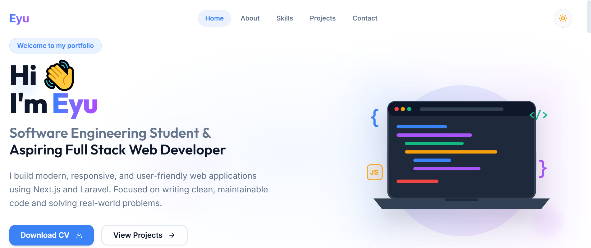
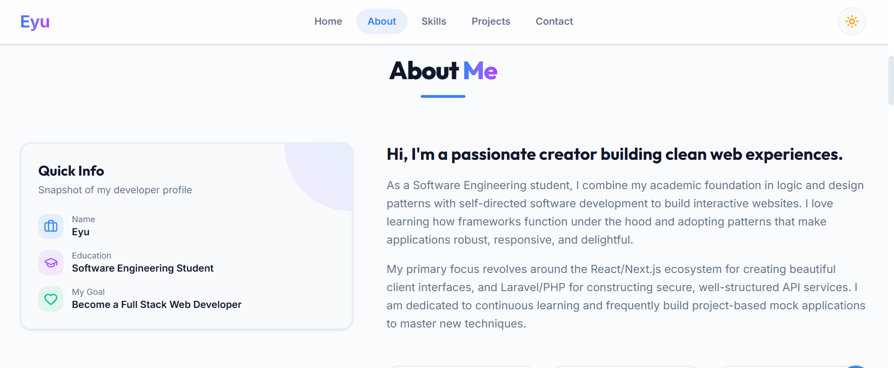

# Personal Portfolio

A modern and responsive personal portfolio website built with Next.js and Tailwind CSS.

---

# Overview

This portfolio showcases my skills, projects, and contact information.

The goal is to present my work professionally and improve my frontend development skills.

---

# Table of Contents

- Overview
- Features
- Technologies
- Installation
- Project Structure
- Screenshots
- Future Improvements
- Author

---

# Features

- Responsive Design
- Dark / Light Mode
- Modern UI
- About Section
- Skills Section
- Projects Section
- Contact Form
- Smooth Animations

---

# Technologies

- Next.js
- React
- Tailwind CSS
- TypeScript
- Git
- GitHub

---

# Project Structure

```
app/
components/
public/
styles/
README.md
```

---

# Installation

```bash
git clone https://github.com/EyuDiv/personal-portfolio.git
```

```bash
cd personal-portfolio
```

```bash
npm install
```

```bash
npm run dev
```

---





---

# Future Improvements

- Blog Page
- Admin Dashboard
- Multi-language Support
- Project Filtering
- Email Integration

---

Author

**Eyu Yimer**

GitHub:
https://github.com/EyuDiv

---

# ⭐ If you like this project, give it a star!
